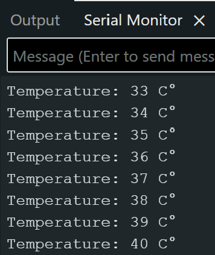

# Lecture 5 - Lab 1 – FreeRTOS Queue

## 1. Purpose

The purpose of this program is to demonstrate how a queue works within Arduino using FreeRTOS. We need a queue in case the producer produces a value, but at that moment the consumer is still busy and cannot receive it. Therefore, we use a queue to temporarily store these values until the consumer can receive them.

## 2. How It Works

Our program uses one queue and two FreeRTOS tasks.

The Sensor Task starts with a temperature of 20 C and sends this value to the queue. After that, it increases the temperature by 1 every second.

The Queue copies the integer values and can store up to five values. The queue also uses FIFO (First In, First Out).

The Display Task checks the queue regularly to see if there is a value available. If it receives a value, the task prints it in the Serial Monitor.

## 3. Serial Monitor

## 4. Reflection

The queue is useful because the Sensor Task can send values even when the Display Task is still busy. The queue copies and stores the values from the Sensor Task until the Display Task receives them. Also, FIFO guarantees that the successfully stored values are received in the correct order. However, if the queue is full, new values can be lost.