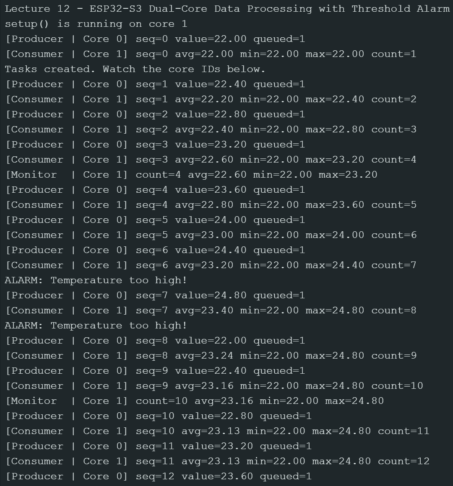
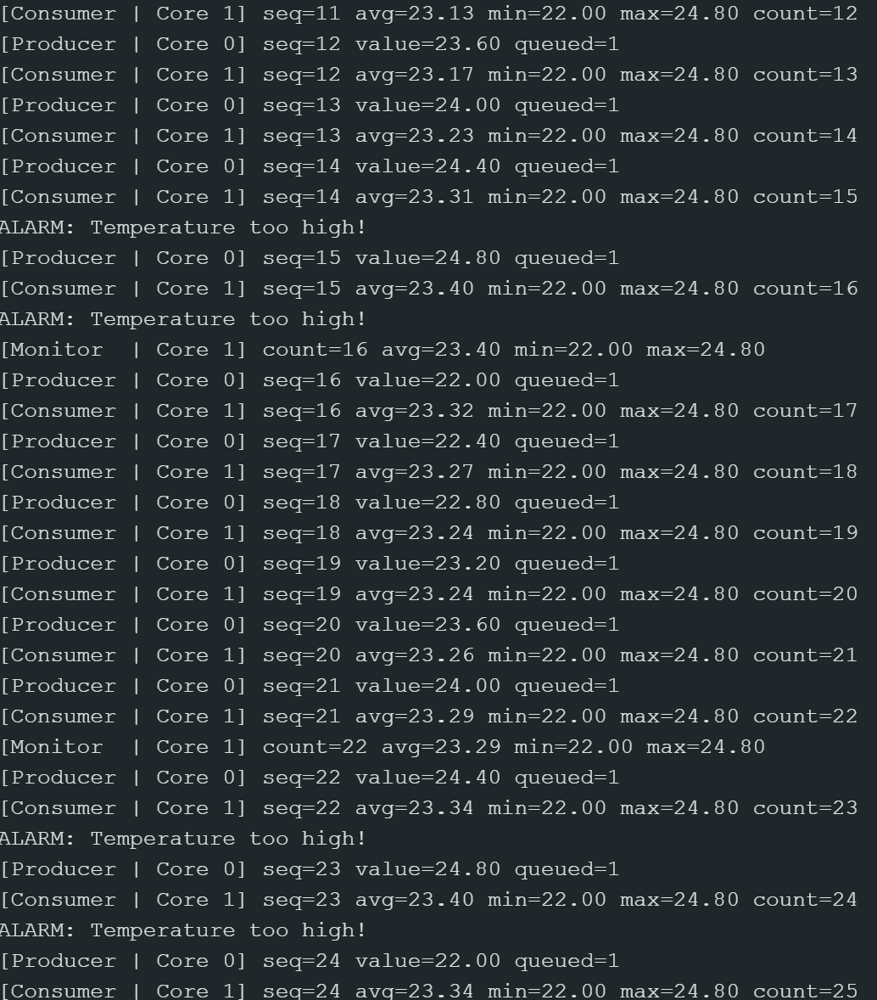

# Lecture 12 - Dual-Core Data Acquisition and Processing

## The application architecture.
This time there are running two FreeRTOS tasks on different cores of our ESPS32-S3. In this program the producer sends simulated temperature values through the queue to the consumer. That one processes these values and update the shared statistics, which the monitor then displays.

## The responsibility of the Producer Task.
The responsibility of the producer is genarating simulated temperature values and that every 500 ms. Also its sequence number and sends it to the queue. Also its running on core 0.

## The responsibility of the Consumer Task.
it receives these values from the queue and after that it calculates the statistics. These are Sample count, running average, minimum value and maximum value. Also I added here that it checks after it gave back the mutex, if the temperature is above the threshold. The consumer is running on core 1.

## The purpose of the Monitor.
Because of the loop function the Monitor copies every three seconds the statistics and prints them to the serial monitor.

## Why the Producer and Consumer use different cores.
Both the Consumer and producer are running on a different core. Because of that both can run parallel. 

## Why a queue is used.
The Queue is used to communicate between tasks. In that case to transfer the readings from the Producer to the consumer. In that program it can store up to eight values. 

## Why the shared statistics require a mutex.
Because the Consumer and Monitor access the same shared statistics. A mutex prevents them from accessing the statistics at the same time point. The statistics are copied while holding the mutex. The mutex is released before printing to the Serial Monitor. So no task is interrupting something from another task.

## What you changed from the lecture demonstration.
I added  for this assignment a threshold alarm with a temperature limit 24 °C
Only if the temperature is above 24 °C, the Consumer prints following warning:
`ALARM: Temperature too high!`
The warning is only printed after releasing the mutex.
It is in lines 79 and 339.

## How to compile, upload and test the application.
- Open my uploaded sketch in Arduino IDE.
- Select the ESP32-S3 Dev Modul board and the correct port.
- Verify that the code is working
- Compile and upload the sketch to the esp32
- Open the Serial Monitor at 115200 baud.
- Check the core IDs, statistics and temperature alarms.

## What can be seen in the Serial Monitor screenshot.

### Screenshot 1

### Screenshot 2 (followup because not enough readings)
